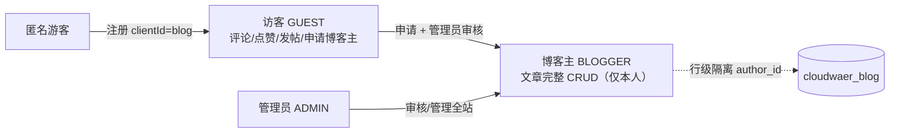
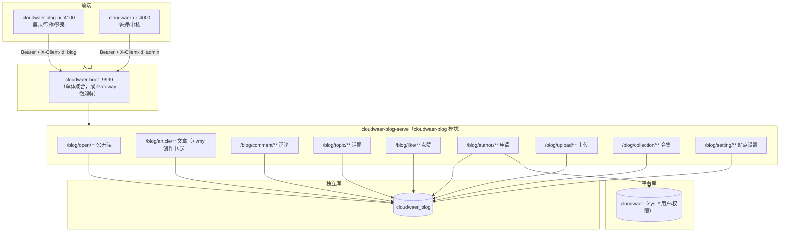

# CloudWaer Blog — 产品与使用说明

| 项 | 内容 |
|----|------|
| 版本 | 1.1 |
| 更新时间 | 2026-10-27 |
| 范围 | 产品定位、总体架构、数据库、后端/前端设计、运行说明 |
| 状态 | 与当前代码实现一致 |
| 配套 | 登录/Token/clientId → [../auth/login-auth.md](../auth/login-auth.md)；专题 → [article-audit.md](article-audit.md) / [collection.md](collection.md) / [blogger-manage.md](blogger-manage.md) / [comment.md](comment.md) |
| 数据库 | 见 `cloudwaer/db/cloudwaer_blog.sql` 与 [../db/conventions.md](../db/conventions.md) |

---

## 1. 产品定位

**CloudWaer Blog** 是搭建在 Cloudwaer 微服务平台上的**博客为主 + 微论坛轻互动**的多作者内容平台。

- **博客为主**：文章（Markdown）、标签、分类、合集、热度、置顶/推荐、归档、搜索；支持 MD/TXT/PDF/DOCX 导入
- **微论坛轻互动**：两级评论（楼中楼）、话题短帖（topic + topic_reply）、点赞
- **多作者入驻**：注册即得访客身份，可申请成为博客主；文章/合集 CRUD 仅限本人（`author_id` 行级隔离）
- **站点可配置**：标题/图标/导航/页面文案/首页与文章布局由 `blog_site_setting` 驱动，前台按配置渲染

### 1.1 角色模型



| 角色 | sys_role | 能力 |
|------|----------|------|
| 匿名 | — | 浏览已发布内容、搜索、归档 |
| 访客 GUEST | id=3（注册默认） | 评论（仅需登录）、点赞、发话题、申请博客主 |
| 博客主 BLOGGER | id=4（申请+审核） | 上述 + 文章/合集 CRUD（`author_id` 限本人） |
| 管理员 ADMIN | id=1 | 全站管理、审核中心、无行级限制 |

### 1.2 端划分

| 端 | 位置 | 端口 | 职责 | clientId |
|----|------|------|------|----------|
| 博客前台 + 写作 | `cloudwaer-blog-ui/` | 4100 | 公开展示、写文章、登录/注册 | `blog` |
| 管理后台 | `cloudwaer-ui/` | 4000 | 内容治理、审核中心、用户/权限 | `admin` |
| 后端 | `cloudwaer/cloudwaer-blog/` | 9999（boot） | 全部 blog 业务 API | — |

---

## 2. 总体架构

### 2.1 架构图



### 2.2 核心约定

- **一模块一库**：blog 数据全部在 `cloudwaer_blog`，与 `sys_*` 所在的 `cloudwaer` 库隔离；boot 多数据源由包路径切面 `BootPackageDataSourceConfig` + 请求路径过滤器 `DynamicDataSourceRouteFilter` 显式路由（`/blog/` → `blog`）
- **两种运行模式互斥**：本地推荐单体 boot（禁 Nacos）；微服务模式按 Authentication → Admin-Serve → Gateway 顺序启动，网关动态路由 `/blog/**` **勿加 StripPrefix**
- **多端 Token 隔离**：对外 Token 为 UUID，登录必须带 `clientId`（admin/blog），请求头带 `X-Client-Id`，两端 Token 不通用（详见登录说明）
- **RBAC 三方一致**：`@PermissionCode` 注解码 ↔ SQL 种子码 ↔ 前端按钮码，风格 `模块:资源:动作`

### 2.3 技术选型

| 层 | 选型 | 说明 |
|----|------|------|
| 后端 | Java 17 / Spring Boot 3.2 / Cloud 2023 / MyBatis-Plus | 复用 cloudwaer-common（Result/BaseEntity/权限过滤器） |
| 注册/登录 | authentication 模块 + Feign 内部接口 | `/auth/register`、`/auth/login` |
| 前端 | Vue3 + TS + Vite + pinia + axios | blog-ui 自定义主题，不套 Element 后台风格 |
| 渲染 | marked + highlight.js | Markdown + 代码高亮 + TOC |
| 存储 | MySQL 8 + Redis | 业务数据 + Token 会话 |

---

## 3. 数据库设计

库：**`cloudwaer_blog`**（初始化脚本 `cloudwaer/db/cloudwaer_blog.sql`）。`sys_*` 种子（角色/权限/网关路由）入 `cloudwaer` 库。

### 3.1 表清单

| 表 | 说明 | 关键字段 |
|----|------|----------|
| `blog_article` | 文章 | title/summary/content(MD)/cover_url/category_id/**author_id**/**author_avatar**/**collection_id**/**collection_sort**/publish_status/is_top/is_recommend/view_count/like_count/comment_count/**heat_score**/publish_time |
| `blog_category` | 分类 | name/slug/description/sort |
| `blog_tag` | 标签 | name/slug |
| `blog_article_tag` | 文章-标签关联 | article_id/tag_id，`uk_article_tag` 唯一索引 |
| `blog_comment` | 两级评论 | article_id/**parent_id**/**root_id**/user_id/nickname/content/like_count/**audit_status** |
| `blog_topic` | 话题短帖（微论坛） | author_id/title/content/audit_status/view_count |
| `blog_topic_reply` | 话题回复 | topic_id/parent_id/root_id/content/audit_status |
| `blog_like` | 点赞记录 | target_type/target_id/user_id，`uk` 防重复 |
| `blog_author_apply` | 博客主申请单 | user_id/reason/audit_status |
| `blog_collection` | 合集 | name/description/cover_url/**author_id**/author_name/**article_count**/sort/is_featured/visibility |
| `blog_site_setting` | 站点设置 | key-value；扁平键 + JSON 键（nav/pages/articleLayout/homeLayout，value 已扩 TEXT） |
| `blog_blogger_status` | 博客主暂停状态 | user_id 唯一、suspend_until（空=永久）、revoked；到期读时惰性恢复 |

> 约定：实体继承 `BaseEntity`（雪花 id、create/update 审计、`status` 逻辑删除 0/1/2）；**中间表唯一索引冲突必须物理删除**（`@TableLogic` 逻辑删会残留物理行，见踩坑 9.1）。

### 3.2 状态机与合集

- 文章 `publish_status`：0 草稿 → **3 待审核** → 1 已发布 → 2 已下线（公开读仅 `=1`；详见 [article-audit.md](article-audit.md)）
- 评论/话题/申请 `audit_status`：0 待审 → 1 通过 / 2 拒绝（管理端审核中心流转）
- 热度 `heat_score`：`对数加权(浏览/点赞/评论) × 时间衰减`，交互增量 + 定时重算（30 天衰减窗口）
- 合集：一篇文章最多属 **一个** 合集（`collection_id` 可空）；合集内顺序 `collection_sort`（NULL 则按 `publish_time` 降序）；删除合集只解绑不删文章；`article_count` 仅统计已发布文章

---

## 4. 后端设计（cloudwaer-blog 模块）

### 4.1 模块结构

```text
cloudwaer/cloudwaer-blog/
├── cloudwaer-blog-api/          # DTO（Article/Comment/Topic/Collection/SiteSetting/...）
└── cloudwaer-blog-serve/
    ├── BlogServeApplication.java     # 微服务启动类
    ├── controller/                   # Open/Article/Comment/Topic/Like/Author/Upload/Collection/Setting
    ├── service/ + service/impl/      # 业务实现（含 author_id 隔离）
    ├── util/ArticleFileParser.java   # MD/TXT/PDF/DOCX → Markdown
    ├── task/BlogHeatTask.java        # 热度定时重算
    ├── entity/ + mapper/             # blog_* 实体与 Mapper
    └── resources/bootstrap.yml       # 微服务 Nacos 配置
```

接线四处：root `pom.xml` modules、`cloudwaer-common-version` 版本管理、boot 内嵌依赖（排 nacos 三件套）、boot 多数据源（yml + 过滤器 + 切面）。

### 4.2 API 清单

**公开读（匿名 = 方法不加权限注解；注意 `enable=false` 反而要求内部调用头）**

| 方法 | 路径 | 说明 |
|------|------|------|
| GET | `/blog/open/article/list` | 已发布分页（keyword/categoryId/tagId） |
| GET | `/blog/open/article/detail` | 详情，浏览量 +1；含合集信息与合集内兄弟文章 |
| GET | `/blog/open/article/archive` | 归档（发布时间倒序） |
| GET | `/blog/open/article/hot` | 热门文章（按 heat_score） |
| GET | `/blog/open/category/list` `/tag/list` | 分类/标签 |
| GET | `/blog/open/comment/list` 等 | 已过审评论树 |
| GET | `/blog/open/topic/list` | 话题列表 |
| GET | `/blog/open/setting` | 站点设置（标题/导航/布局等，驱动前台渲染） |

**管理/用户写（带权限码 + Token）**

| 路径 | 权限码 | 角色 |
|------|--------|------|
| `/blog/article/save|update|delete|page|detail` | `blog:article:add/edit/delete/view` | BLOGGER（本人）/ ADMIN |
| `/blog/article/import` | `blog:article:add` | multipart ≤20MB，MD/TXT/PDF/DOCX → 表单回填 |
| `/blog/article/my/*` | `@RequireLogin` | 创作中心：本人文章 CRUD（blog-ui） |
| `/blog/comment/*` | `@RequireLogin` | 发表仅需登录；删除=本人或 ADMIN（按钮码已收敛） |
| `/blog/topic/*` | `blog:topic:add|delete|audit` | GUEST 发帖 / ADMIN |
| `/blog/like/toggle` | `@RequireLogin` | 登录即可点赞（1文章 2评论 3话题 4回复）；`blog:like` 权限码从未进种子，已收敛为登录级 |
| `/blog/author/apply|audit` | `blog:author:apply|audit` | GUEST 申请 / ADMIN 审核 |
| `/blog/upload/image` | 登录即可 | 图片 → `/blog/uploads/**` 静态映射 |
| `/blog/collection/*` | `blog:collection:view/add/edit/delete/sort` | 管理端；非 ADMIN 仅本人 |
| `/blog/collection/my/*` | `@RequireLogin` | 创作中心：合集 CRUD、绑定/移出文章、合集内排序 |
| `/blog/setting` `GET` / `POST /save` | `blog:setting:view` / `edit` | 管理端站点配置 |

### 4.3 注册与入驻

```text
POST /auth/register {username,password,nickname,clientId:"blog"}
  → AdminFeignClient.registerUser（X-Internal-Call）
    → /admin/user/register：查重 + 解析 GUEST 角色 + BCrypt + 绑定
```

- 注册成功即可评论/发帖；**申请博客主**走 `blog_author_apply` 单，管理员在审核中心通过后 `assignRoles(BLOGGER)`（会刷新在线 Token 权限）
- 登录必须带 `clientId=blog`；blog-ui 用 localStorage `blog_token`，请求头 `X-Client-Id: blog`

### 4.4 行级数据隔离（必读）

功能权限只管「能不能」，数据权限管「对谁」：

```java
// service 层统一收口（非 ADMIN 仅本人）
Long uid = SecurityContextUtil.getCurrentUserId();
if (!isAdmin(uid) && !uid.equals(article.getAuthorId())) {
    throw new BusinessException("无权操作他人文章");
}
```

- ADMIN 判定：角色含 role id=1
- update/delete/save 均校验；列表查询对非 ADMIN 追加 `author_id = uid`
- **合集** 同规则：管理端 CRUD 与创作中心 `/my/*` 均校验 `collection.author_id`

### 4.5 站点设置（blog_site_setting）

- 存储：key-value；扁平键 `siteTitle/siteDescription/favicon/enableSearch/layout/footerText`
- 复杂配置：独立键 `nav` / `pages` / `articleLayout` / `homeLayout`，value 为 **JSON 字符串**（列已扩 TEXT）
- DTO `SiteSettingDTO` 将 JSON 键展开为 `NavSettingItem` / `PageSettingItem` / `ArticleLayoutSetting` / `HomeLayoutSetting`
- 管理端 `SiteSetting.vue` 分组 Tab（站点/导航/页面/布局）；前台 `GET /blog/open/setting` 匿名读，导航与首页/文章侧栏模块按配置渲染（空则回落默认）

### 4.6 文章导入

- `POST /blog/article/import`：multipart 文件（MD/TXT/PDF/DOCX，≤20MB）
- `ArticleFileParser` 解析为 Markdown；**标题默认文件名**（去扩展名）；**不直接落库**，前端回填表单后再 save/my/save
- 依赖：pdfbox + poi-ooxml；按钮码可用 `blog:article:import` 或复用 add

---

## 5. 前端设计

### 5.1 cloudwaer-blog-ui（:4100）

```text
cloudwaer-blog-ui/
├── src/
│   ├── api/            request.ts（Result 解码拦截器）+ blog.ts（类型化接口）
│   ├── layouts/        BlogLayout（顶栏导航/搜索/头像悬停菜单/页脚，按站点配置渲染）
│   ├── views/          Home / Article / Write / Login / Profile / Forum / Topic / Tag / Category / Archive / About
│   ├── components/
│   │   ├── home/       Featured/ArticleList/Nav/TagCloud/HotArticles/... 卡片
│   │   └── article/    Author/ReadingInfo/Action/Related/Toc 卡片 + Mermaid 渲染
│   ├── config/         layoutModules.ts（首页/文章侧栏模块编排默认值）
│   ├── stores/         auth + settings（暗色/字号/布局/中英 + 站点名）
│   └── style.css       设计令牌：纸白 #FAF9F6 / 墨 #23262B / 靛蓝 #4C6EF5
├── vite.config.ts      :4100，/api → VITE_GATEWAY_ORIGIN（默认 boot :9999）
└── package.json        vue3 + router + pinia + axios + marked + highlight.js + mermaid + element-plus
```

- **首页**：约 80% 三栏容器 `min(80vw,1600)`，左右 `220|1fr|280`；精选大卡 + 文章流 + 侧栏；模块可由 `homeLayout.modules` 编排
- **详情**：约 80% 三栏 `200|1fr|240`（左作者/阅读信息/互动/相关；中正文；右 TOC）；Markdown + 代码高亮 + **Mermaid 图** + 阅读进度 + 合集/相关阅读切换；TOC 滚动高亮；浏览量调 detail 即 +1
- **写作** `/write`：登录（clientId=blog）+ `blog:article:add` 后可用；**分屏 MD 编辑+预览**（深色跟随主题）；标签可搜可建；可选合集；支持文件导入
- **个人中心** `/profile`：概览 / 我的文章 / **我的合集**（建改删、加入/移出文章）/ 账号
- **顶栏**：放大；写文章入口；头像悬停矩形菜单（设置/个人中心/退出）
- **管理端文章页只管浏览/预览/编辑/删除**，发布写作在 blog-ui（架构决策 2026-10-25）

### 5.2 cloudwaer-ui 管理端

- `views/blog/`：文章管理（卡片布局 + 预览/前台）、审核中心（文章/评论/博客主申请）、标签/分类、合集管理、站点设置（含布局编辑）
- 列表页为卡片 + 工具条布局，详见 [../admin-ui/layout-spec.md](../admin-ui/layout-spec.md)
- 按钮权限接入 `config/permission.ts`；详见 [../rbac/overview.md](../rbac/overview.md)

---

## 6. 运行与验证

> 前置：JDK 17、Maven、Node、MySQL 8、Redis；平台已可启动（见 [../platform/deployment.md](../platform/deployment.md)）。

1. 导入全量库 `cloudwaer` 与 `cloudwaer_blog`（见 [../db/conventions.md](../db/conventions.md)）
2. 启动 boot（:9999）与 `cloudwaer-blog-ui`（:4100）
3. 建议走一遍：注册登录（clientId=blog）→ 写文章/选合集 → 发布 → 匿名浏览列表与详情 → 评论/点赞 → 个人中心 → 管理端审核与站点设置

后端构建示例：

```bash
mvn -pl cloudwaer-blog/cloudwaer-blog-serve -am -DskipTests package
```

---

## 7. 关键设计说明

| 主题 | 说明 |
|------|------|
| 产品形态 | 博客为主 + 微论坛轻互动 |
| 数据库 | 独立库 `cloudwaer_blog`，与平台 `sys_*` 隔离 |
| 多端 Token | clientId 隔离 admin / blog，两端不通用 |
| 公开接口 | 方法不加权限注解 = 匿名可读 |
| 写作入口 | blog-ui `/write`；管理端负责治理与审核 |
| 数据隔离 | 非 ADMIN 仅能操作本人文章/合集（`author_id`） |
| 站点配置 | key-value + 复杂项 JSON，前台按配置渲染 |
| 合集 | 一文一合集 + 序号排序 |
| 文章导入 | 解析后回填表单，作者确认后再保存 |

---

## 8. 常见问题

| 问题 | 说明 |
|------|------|
| 发布后前台看不到 | 是否处于「待审核」；公开接口只返回已发布 |
| 草稿能否匿名访问 | 不能；仅作者本人或管理员可见 |
| 博客主暂停后能否发布 | 不能；到期后自动恢复可发 |
| 导入 Word/PDF 后格式 | 转为 Markdown 文本，复杂版式可能丢失 |

---

## 9. 功能概览

| 能力 | 说明 |
|------|------|
| 文章 | Markdown、草稿/发布/下线/待审、置顶推荐（管理端）、导入 MD/TXT/PDF/DOCX |
| 互动 | 两级评论、附图、质量分排序；话题短帖；点赞 |
| 组织 | 分类、标签、合集（一文一合集） |
| 治理 | 审核中心（文章/评论/博客主申请）、站点设置、博客主暂停/取消 |
| 前台 | 三栏布局、写作页、个人中心、暗色、配置驱动导航与模块编排 |

---

## 10. 变更记录

| 日期 | 说明 |
|------|------|
| 2026-10-25 | 初版：主线架构与登录 clientId 对齐 |
| 2026-10-27 | 1.1：合集、站点设置、导入、三栏/写作、评论与博客主管理等 |

---

*文档描述以当前代码与全量库为准。*
